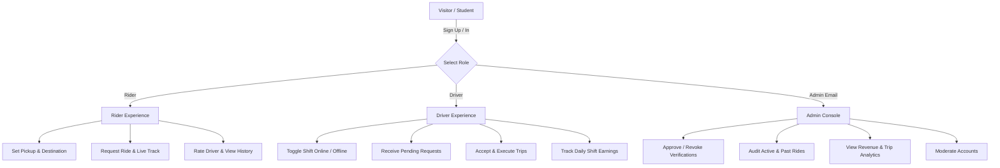

# 🚗 CampusRide (RideOn) — Campus Mobility Redefined

[](https://react.dev/)
[](https://www.typescriptlang.org/)
[](https://tailwindcss.com/)
[](https://firebase.google.com/)
[](https://developers.google.com/maps)
[](https://vitejs.dev/)

> **CampusRide** is a real-time, peer-to-peer campus ride-hailing and mobility network designed exclusively for university students, faculty, and campus staff. It connects verified student riders with peer drivers for safe, punctual, and transparently priced transit across lecture halls, faculties, hostels, off-campus student housing, and major campus landmarks.

---

## 📌 Table of Contents

1. [🎯 Project Aim & Vision](#-project-aim--vision)
2. [📊 Current Project Status](#-current-project-status)
3. [✨ Key Features](#-key-features)
4. [👥 Role-Based Capabilities (RBAC)](#-role-based-capabilities-rbac)
5. [🏗️ System Architecture & Tech Stack](#️-system-architecture--tech-stack)
6. [🗄️ Firestore Data Model](#️-firestore-data-model)
7. [🚀 Quickstart & Local Setup](#-quickstart--local-setup)
8. [⚙️ Configuration & Environment Variables](#️-configuration--environment-variables)
9. [🛡️ Security & Access Control](#️-security--access-control)
10. [🔮 Future Features & Engineering Roadmap](#-future-features--engineering-roadmap)
11. [📚 Additional Documentation](#-additional-documentation)

---

## 🎯 Project Aim & Vision

### The Problem
University campuses are often sprawling environments where transit between remote hostels, sports complexes, libraries, science laboratories, and main gates is inefficient or unsafe:
- **Commercial ride-hailing services** (Uber/Bolt/Lyft) frequently have prohibitive minimum fares, long external wait times, or restricted access through campus security gates.
- **Campus shuttle buses** are overcrowded, run on rigid schedules, and do not provide door-to-door or late-night coverage.
- **Walking late at night** across isolated parts of campus poses safety concerns for students.
- **Student car owners** commute daily with empty passenger seats, missing opportunities to offset fuel and maintenance expenses while helping peers.

### The Aim
CampusRide solves this by creating a **closed-loop campus transit ecosystem**:
- **Peer-to-Peer Accountability**: Both riders and drivers are university community members with verified student or staff identities.
- **Flat, Student-Friendly Fares**: Transparent, predictable pricing calculated specifically for intra-campus distances without exploitative surge pricing.
- **Real-Time Visual Tracking**: Live Google Maps integration showing exact driver positioning, estimated pickups, and drop-offs.
- **Safety First**: Verified profiles, active ride state machines, administrative safety oversight, and emergency safeguards.

---

## 📊 Current Project Status

| Milestone / Component | Status | Details |
|---|:---:|---|
| **Landing Page** | ✅ Complete | High-performance responsive UI with Framer Motion scroll parallax, hero video visualizer, feature showcases, trust cards, and dynamic CTA routing. |
| **Authentication & Role Selection** | ✅ Complete | Google OAuth sign-in with instant role switching (`Rider` vs `Driver`), plus one-click mock student account testing (Rider, Driver, Admin) backed by anonymous Firebase credentials. |
| **Rider Experience (`/app/rider`)** | ✅ Complete | Interactive campus map, simulated or customized pickup & drop-off pins, upfront fare calculation, instant request dispatching, and live ride status tracking (`pending` → `accepted` → `ongoing` → `completed`). |
| **Driver Experience (`/app/driver`)** | ✅ Complete | Real-time shift status toggle (Online/Offline), live driver pool sync, instant pending ride request alerts, one-click accept, and trip progression controls. |
| **Administrative Hub (`/app/admin`)** | ✅ Complete | Protected console for system administrators (`iyanuolalegan@gmail.com`), real-time user directory, verification badge toggles, ride history auditing, user deletion, and Recharts analytics. |
| **Database & Realtime Sync** | ✅ Complete | Firebase Firestore reactive listeners (`onSnapshot`) ensuring sub-second updates across riders, drivers, and the administration console. |
| **Security Rules** | ✅ Complete | Production `firestore.rules` enforcing role-based authorization, owner write restrictions, and administrative overrides. |
| **Fullstack Backend** | ✅ Complete | Express.js proxy server with Vite SPA dev middleware integration (`server.ts`) for production Cloud Run deployment. |

---

## ✨ Key Features

- **⚡ Instant Campus Dispatch**: When a student requests a ride, all online drivers on campus receive real-time push notifications of the pending request with pickup/dropoff coordinates.
- **🗺️ Interactive Campus Maps**: Powered by `@vis.gl/react-google-maps` with custom-styled pins for drivers (orange), pickup spots (blue), and destinations (emerald green).
- **🎭 Multi-Role Flexibility**: Seamlessly onboard as a passenger or register as a driver. Users can preview driver mode or switch modes based on their daily schedule.
- **🛡️ Built-in Admin Safety Console**: Platform operators can audit all active rides, review unverified users, and revoke access for bad actors immediately.
- **📱 Fully Responsive Design**: Optimized for mobile devices, tablets, and desktop workstations with tailored navigation (bottom tab bar for mobile, persistent sidebar for desktop).

---

## 👥 Role-Based Capabilities (RBAC)



### 1. Rider
- Select pickup and drop-off points with preset campus spots (Hostels, Lecture Theatres, Main Gates, Libraries) or custom pins.
- View upfront estimated fares before requesting.
- Live tracking of incoming drivers on the campus map.
- Review historical trips and trip receipts.

### 2. Driver
- Toggle online status anytime between classes or study sessions.
- Automatically register in the campus-wide `drivers` collection with live coordinates.
- Review pending trip requests with rider name, pickup spot, destination, and calculated fare.
- Transition trip states: **Accept Request** ➔ **Mark Trip Ongoing** ➔ **Complete Trip**.
- Monitor shift metrics including completed rides and accrued earnings.

### 3. Administrator
- Automatically granted to authorized administrator accounts (default: `iyanuolalegan@gmail.com`).
- Full read and write authority over `users`, `drivers`, and `rides`.
- One-click verification toggle for driver safety audits.
- Real-time revenue statistics, ride volume distribution, and moderation controls.

---

## 🏗️ System Architecture & Tech Stack

```
┌─────────────────────────────────────────────────────────────┐
│                    Client (React 19 SPA)                    │
│  - React Router v7 (Protected & Role-based routes)          │
│  - Framer Motion (Transitions & Video animations)           │
│  - Tailwind CSS v4 (Modern dark mode utility styling)       │
│  - Google Maps Platform (@vis.gl/react-google-maps)         │
│  - Recharts (Analytics visualizer)                          │
└──────────────┬──────────────────────────────┬───────────────┘
               │                              │
      REST & Static Assets            Realtime Sync & Auth
               │                              │
┌──────────────▼──────────────┐ ┌─────────────▼───────────────┐
│     Express Node Server     │ │      Firebase Services      │
│  - Vite Dev Middleware      │ │  - Firebase Authentication  │
│  - Production SPA Serving   │ │  - Cloud Firestore          │
│  - Health & Matching API    │ │  - Security Rules (RBAC)    │
└─────────────────────────────┘ └─────────────────────────────┘
```

### Core Technologies
- **Frontend Framework**: React 19, TypeScript 5.8, Vite 6
- **Routing**: `react-router-dom` v7 with role-guarded routes (`PrivateRoute`, `RoleRoute`)
- **Styling & Motion**: Tailwind CSS v4, `motion/react` (Framer Motion v12)
- **Database & Identity**: Firebase Firestore 12.12, Firebase Authentication (Google Auth Provider & Anonymous fallback)
- **Map & Spatial**: Google Maps Platform JavaScript API via `@vis.gl/react-google-maps`
- **Charts & Telemetry**: Recharts v3
- **Runtime**: Node.js 22 LTS, Express 4.21, `tsx`

---

## 🗄️ Firestore Data Model

The database structure is validated by `firebase-blueprint.json` and secured by `firestore.rules`:

### 1. `users/{userId}`
Represents student riders, student drivers, and platform administrators.
```typescript
interface User {
  uid: string;
  name: string;
  email: string;
  role: 'rider' | 'driver' | 'admin';
  verified: boolean;          // Requires ID verification for drivers
  rating: number;            // Rating out of 5.0
  studentIdUrl?: string;     // URL to uploaded student identification card
  createdAt: Timestamp;
  updatedAt?: Timestamp;
}
```

### 2. `drivers/{userId}`
Represents drivers who are actively registered in the pool and their real-time location.
```typescript
interface Driver {
  userId: string;
  vehicleInfo: string;       // e.g. "Toyota Corolla - Silver (AAA-123-XY)"
  isAvailable: boolean;      // Shift toggle
  currentLocation: {
    lat: number;
    lng: number;
  };
  updatedAt: Timestamp;
}
```

### 3. `rides/{rideId}`
Lifecycle tracking of individual ride requests from creation to settlement.
```typescript
interface Ride {
  id?: string;
  riderId: string;
  riderName: string;
  driverId?: string;
  driverName?: string;
  pickupLocation: {
    address: string;
    lat: number;
    lng: number;
  };
  destination: {
    address: string;
    lat: number;
    lng: number;
  };
  status: 'pending' | 'accepted' | 'ongoing' | 'completed' | 'cancelled';
  fare: number;              // In campus currency units (e.g., ₦250)
  paymentMethod: 'cash' | 'wallet';
  riderRating?: number;
  driverRating?: number;
  createdAt: Timestamp;
  updatedAt: Timestamp;
}
```

---

## 🚀 Quickstart & Local Setup

### Prerequisites
- [Node.js](https://nodejs.org/) (version 20 LTS or 22 LTS recommended)
- `npm` or `bun`
- A Firebase project with Firestore and Authentication enabled
- (Optional) A Google Maps Platform API key

### 1. Clone the Repository
```bash
git clone <repository-url>
cd rideon-campus
```

### 2. Install Dependencies
```bash
npm install
```

### 3. Configure Environment Variables
Copy `.env.example` to `.env.local` or `.env`:
```bash
cp .env.example .env
```
Populate the necessary values:
```env
# Optional: Set for live interactive maps
GOOGLE_MAPS_PLATFORM_KEY=AIzaSy...

# Optional: Gemini API Key for intelligent features
GEMINI_API_KEY=...
```

### 4. Run the Development Server
```bash
npm run dev
```
Open your browser at `http://localhost:3000` to access the application.

### 5. Build for Production
```bash
npm run build
npm start
```

---

## ⚙️ Configuration & Environment Variables

| Variable | Description | Default / Required |
|---|---|:---:|
| `PORT` | Listening port for the Express application server | `3000` |
| `NODE_ENV` | Environment mode (`development` or `production`) | `development` |
| `GOOGLE_MAPS_PLATFORM_KEY` | Google Maps JavaScript API key with Maps JavaScript API enabled | *Optional (Fallback UI provided)* |
| `GEMINI_API_KEY` | Google Gemini API key for future AI dispatch & OCR features | *Optional* |
| `APP_URL` | Canonical public hosting URL | Injected by Cloud Run |

---

## 🛡️ Security & Access Control

Security is enforced at the database level using Firestore Security Rules (`firestore.rules`):
- **User Document Access**:
  - Any authenticated user can read their own profile.
  - Profile creation is allowed upon first sign-in.
  - Updates to roles and verification flags are restricted strictly to administrators.
- **Driver State**:
  - Any user can read the active drivers collection to view available cars on the map.
  - Only the driver or an administrator can modify a driver's shift status and coordinates.
- **Ride Lifecycle**:
  - Riders can create `pending` ride records with their own `riderId`.
  - Drivers can update ride records to `accepted`, `ongoing`, or `completed` when participating in the ride.
  - Unauthenticated access is blocked across all collections.

---

## 🔮 Future Features & Engineering Roadmap

Detailed milestone planning is maintained in [`docs/ROADMAP.md`](./docs/ROADMAP.md). Highlights of upcoming releases include:

### 🌟 Milestone 1: Automated Student Verification & Security (Near-Term)
- **University Email Domain Enforcer**: Automatically validate institution-specific email domains (`@student.edu`, `@alumni.edu`).
- **Gemini Vision Student ID OCR**: Instant photo scanning of physical student identification cards with automated name and matriculation number extraction.
- **Emergency SOS Broadcast**: In-ride panic trigger alerting campus security dispatchers with real-time GPS telemetry and passenger details.

### 🚗 Milestone 2: Ride Pooling & Smart Campus Routing
- **Split-Fare Carpooling**: Match multiple students departing from the same residential dorm or returning from evening lectures along identical trajectories.
- **Campus Route Optimizer**: Custom pathfinding algorithms aware of pedestrian walkways, campus speed limits, and pedestrian-only campus hours.
- **Scheduled Rides**: Book rides in advance for early morning exams, lab sessions, or airport shuttle transfers.

### 💳 Milestone 3: Digital Campus Wallet & Cashless Transit
- **Campus Wallet System**: In-app balance top-up via card, bank transfer, or student meal card balance.
- **Automated Driver Payouts**: Instant end-of-shift driver payouts with configurable campus platform commission fees.
- **Promo Codes & Department Subsidies**: Subsidized transit vouchers for student government reps, evening library staff, and student-athletes.

### 💬 Milestone 4: Communication & Offline Resilience
- **Masked In-App Chat & VoIP Calls**: Privacy-preserving direct messaging between riders and drivers without revealing personal phone numbers.
- **Progressive Web App (PWA) with Offline Caching**: Persistent offline shell and caching for seamless operation across campus areas with poor cellular coverage.
- **FCM Push Notifications**: Real-time push alerts for driver arrival, trip initiation, and receipts.

---

## 📚 Additional Documentation

For detailed technical references, refer to the guides in the `docs/` folder:

- **[System Architecture Guide (`docs/ARCHITECTURE.md`)](./docs/ARCHITECTURE.md)**: In-depth technical breakdown of state machines, real-time Firestore synchronization, and component hierarchy.
- **[User & Administrator Guide (`docs/USER_GUIDE.md`)](./docs/USER_GUIDE.md)**: End-to-end user manuals for riders, student drivers, and platform operators.
- **[API & Data Model Reference (`docs/API_AND_DATA_MODEL.md`)](./docs/API_AND_DATA_MODEL.md)**: Database schemas, field definitions, index requirements, and REST endpoints.
- **[Deployment & Cloud Setup Guide (`docs/DEPLOYMENT_AND_SETUP.md`)](./docs/DEPLOYMENT_AND_SETUP.md)**: Step-by-step production deployment instructions on Cloud Run, Google Maps configuration, and Firebase deployment.
- **[Future Roadmap & Specifications (`docs/ROADMAP.md`)](./docs/ROADMAP.md)**: Technical specifications and implementation blueprints for future phases.

---

## 📄 License & Attribution

This project is built and maintained for university student communities. Designed and developed with modern web engineering standards. All rights reserved.
