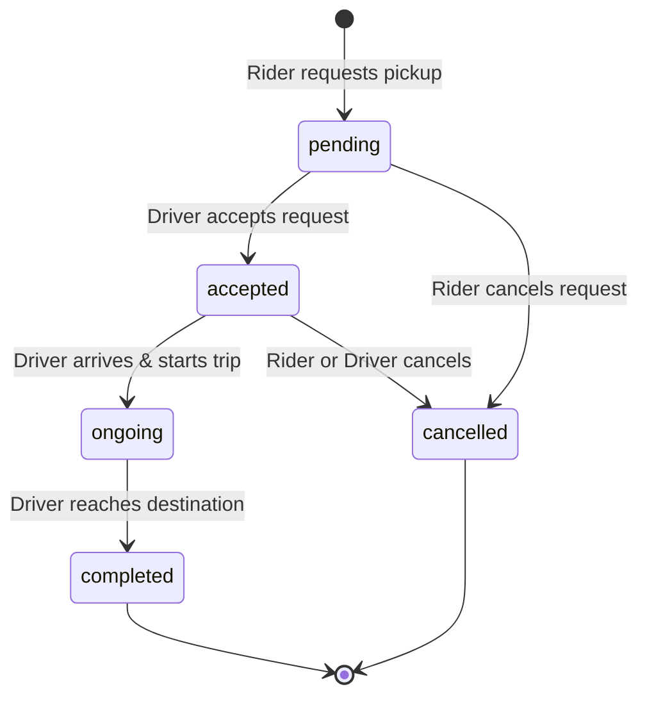
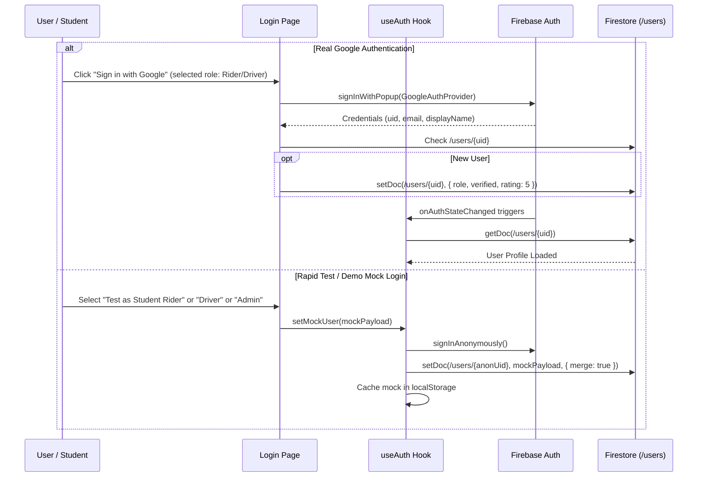

# 🏛️ CampusRide Architecture & System Design

This document details the architectural blueprints, component hierarchies, data flows, and state management mechanisms powering the CampusRide platform.

---

## 1. High-Level System Architecture

CampusRide employs a hybrid reactive architecture consisting of a **React 19 Single-Page Application (SPA)**, an **Express.js API & proxy server**, and a **Google Cloud Firebase backend** (Firestore and Firebase Authentication).

```
┌────────────────────────────────────────────────────────────────────────┐
│                        Client Tier (Browser)                           │
│                                                                        │
│   ┌────────────────────┐   ┌───────────────────┐   ┌───────────────┐   │
│   │   Authentication   │   │     Navigation    │   │  Map Display  │   │
│   │    (Google/Mock)   │   │  (React Router 7) │   │ (Google Maps) │   │
│   └─────────┬──────────┘   └─────────┬─────────┘   └───────┬───────┘   │
│             │                        │                     │           │
│             ▼                        ▼                     ▼           │
│   ┌────────────────────────────────────────────────────────────────┐   │
│   │                      Application Pages                         │   │
│   │   [LandingPage]  [Login]  [Dashboard]  [Rider]  [Driver] [Admin] │   │
│   └───────────────────────────────┬────────────────────────────────┘   │
│                                   │                                    │
│   ┌───────────────────────────────┴────────────────────────────────┐   │
│   │                State & Realtime Sync Layer                     │   │
│   │     - useAuth (Context + LocalStorage + Firebase Observer)     │   │
│   │     - Firestore onSnapshot Observers (drivers, rides, users)   │   │
│   └───────────────────────────────┬────────────────────────────────┘   │
└───────────────────────────────────┼────────────────────────────────────┘
                                    │
                  ┌─────────────────┴─────────────────┐
                  ▼                                   ▼
┌───────────────────────────────────┐   ┌────────────────────────────────┐
│        Server Tier (Node/Express) │   │   Database Tier (Firestore)    │
│  - server.ts                      │   │  - /users collection           │
│  - Static Asset Delivery          │   │  - /drivers collection         │
│  - Vite Dev Middleware            │   │  - /rides collection           │
│  - REST matching & health check   │   │  - Cloud Security Rules        │
└───────────────────────────────────┘   └────────────────────────────────┘
```

---

## 2. Component Hierarchy & Navigation Flow

### Routing Structure (`src/App.tsx`)
```
/ (LandingPage)
│
├── /login (Login & Role Choice)
│
└── /app (PrivateRoute -> Layout)
    ├── /app (Dashboard - Role-aware summary)
    ├── /app/rider (RoleRoute: 'rider' | 'admin')
    ├── /app/driver (RoleRoute: 'driver' | 'admin')
    └── /app/admin (RoleRoute: 'admin')
```

### Route Guards
1. **`PrivateRoute`**:
   - Inspects `useAuth().user`.
   - If `loading` is true, renders an initialization screen.
   - If unauthenticated, redirects to `/login`.
2. **`RoleRoute`**:
   - Checks `user.role` against `allowedRoles`.
   - Prevents unauthorized access (e.g., standard riders accessing the driver dispatch queue or admin controls).
   - If unauthorized, gracefully redirects back to `/app`.

---

## 3. Real-Time Synchronization & State Machines

Unlike traditional polling architectures, CampusRide is fully reactive, utilizing Firestore real-time snapshot listeners (`onSnapshot`) to deliver sub-second state updates without web-socket infrastructure overhead.

### Ride State Machine
A ride progresses through deterministic, verifiable states:



### State Definitions & Actions:
1. **`pending`**:
   - Created by Rider (`RiderPage.tsx` -> `addDoc(collection(db, 'rides'))`).
   - Observed by all drivers who have set their shift to `Online`.
   - Rider can cancel at this stage with zero penalty.
2. **`accepted`**:
   - Assigned when a driver clicks **Accept** (`DriverPage.tsx` -> `updateDoc` setting `driverId`, `driverName`, and `status = 'accepted'`).
   - The rider's active ride listener detects the assignment instantly, updating the UI to show driver details.
3. **`ongoing`**:
   - Driver marks that the student passenger has boarded and the vehicle is in motion.
   - Telemetry tracks ETA towards the destination coordinates.
4. **`completed`**:
   - Driver marks arrival at the campus destination.
   - Triggers rating prompt for rider and updates driver's total earnings.

---

## 4. Authentication Architecture (`src/hooks/useAuth.tsx`)

CampusRide implements a unified authentication abstraction:



---

## 5. Map & Spatial Architecture (`src/components/MapComponent.tsx`)

- Uses `@vis.gl/react-google-maps` wrapping the Google Maps JavaScript API.
- Configured with dark mode styling (`colorScheme="DARK"`) matching the high-contrast aesthetic.
- Renders **`AdvancedMarker`** nodes with distinct pin colors:
  - 🟠 **Driver Pins**: Dynamic orange pins marking active student drivers.
  - 🔵 **Pickup Pins**: Blue pins representing passenger waiting spots.
  - 🟢 **Destination Pins**: Emerald green pins representing campus arrival points.
- Graceful degradation: When no Google Maps key is provided in development, a clean inline instruction card displays instructions on configuring `GOOGLE_MAPS_PLATFORM_KEY`.

---

## 6. Security & Rule Enforcement (`firestore.rules`)

1. **Role Identification**:
   - An admin is identified if their token email equals `iyanuolalegan@gmail.com` OR their document in `/users/$(request.auth.uid)` has `role == 'admin'`.
2. **Document Partitioning**:
   - `/users/{userId}`: Only owners and admins can edit profiles; verification badges can only be modified by admins.
   - `/drivers/{userId}`: Driver shift coordinates and online toggles can only be modified by the authenticated driver.
   - `/rides/{rideId}`: Creation permitted to authenticated riders; state changes restricted to participating rider or assigned driver.
